# MINI DOSSIER DE SOFTWARE SEGURO
## Tarea 4.1: Ciclo de Vida de Desarrollo de Software Seguro (SSDLC)
### Asignatura: Ingeniería de Software II (Laboratorio)
**Docente:** Alex Fernando Huillca Huaman  
**Institución:** Universidad Nacional de San Antonio Abad del Cusco (UNSAAC)  
**Escuela Profesional:** Ingeniería Informática y de Sistemas  
**Proyecto Evaluado:** Sistema de Gestión de Tareas Académicas Seguras (`KawsayTasks`)  
**Repositorio GitHub:** [https://github.com/GamoLG/PRACTICA-4-INGENIERIA-DE-SOFTWARE-II](https://github.com/GamoLG/PRACTICA-4-INGENIERIA-DE-SOFTWARE-II)  
**Despliegue en Producción:** [https://practica-4-ingenieria-de-software-ii.onrender.com](https://practica-4-ingenieria-de-software-ii.onrender.com)  

---

## 1. MAPA SSDLC (Security Software Development Life Cycle)

Diagrama integral de las **seis etapas** del ciclo de vida de desarrollo de software seguro, mapeando las amenazas identificadas y los controles de ingeniería implementados en el proyecto:

```mermaid
flowchart TD
    subgraph E1["1. Requisitos de Seguridad"]
        A1["Amenazas: Ambigüedad en control de acceso, omisión de límites de entrada."]
        C1["Controles: Formulación de 5 requisitos de seguridad verificables (RS), definición de DTOs estrictos."]
    end

    subgraph E2["2. Diseño y Arquitectura"]
        A2["Amenazas: Spoofing, Tampering, Information Disclosure (STRIDE)."]
        C2["Controles: Modelo STRIDE, RBAC jerárquico (Estudiante/Docente/Admin), JWT con jti único, expiración de 60 min."]
    end

    subgraph E3["3. Codificación y Hardening"]
        A3["Amenazas: Inyección SQL (CWE-89), IDOR (CWE-639), XSS (CWE-79), Fuerza Bruta."]
        C3["Controles: Prepared Statements, control de propiedad en servidor (HTTP 403), bcrypt (12 rondas), bloqueo progresivo (HTTP 429)."]
    end

    subgraph E4["4. Pruebas y Verificación"]
        A4["Amenazas: Falsos positivos/negativos, regresiones de seguridad no detectadas."]
        C4["Controles: Suite automatizada de 19 pruebas negativas en pytest, análisis SAST con Pylint y Bandit."]
    end

    subgraph E5["5. Despliegue y Liberación"]
        A5["Amenazas: Fuga de credenciales, cabeceras HTTP inseguras, configuraciones permisivas de CORS."]
        C5["Controles: Inyección de Security Headers, regex CORS para subdominios Render, SECRET_KEY desacoplada."]
    end

    subgraph E6["6. Operaciones y Mantenimiento"]
        A6["Amenazas: Ataques activos no detectados, repudio de transacciones, inyección en bitácoras."]
        C6["Controles: Auditoría continua en audit.log sin registro de payloads sensibles (OWASP Log Injection)."]
    end

    E1 --> E2 --> E3 --> E4 --> E5 --> E6
```



### Tabla Resumen de Etapas del SSDLC

| Etapa SSDLC | Objetivo de Seguridad | Amenazas Evaluadas | Controles Técnicos Implementados |
| :--- | :--- | :--- | :--- |
| **1. Requisitos** | Definir criterios de aceptación de seguridad cuantificables y no negociables. | Omisión de restricciones de tipo, falta de validación de entradas. | Especificación formal de requisitos verificables y contratos Pydantic con `extra="forbid"`. |
| **2. Diseño** | Modelar arquitectura de defensas en profundidad y límites de confianza. | Suplantación (Spoofing), Fuga de Información, Elevación de Privilegios. | Modelado STRIDE, diseño RBAC de 3 capas, tokens JWT stateless con regeneración de sesión (`jti`). |
| **3. Desarrollo** | Aplicar prácticas de codificación segura para erradicar fallos OWASP. | Inyección SQL (CWE-89), IDOR (CWE-639), XSS (CWE-79), Fuerza Bruta. | *Prepared Statements* (`?`), chequeo estricto `owner_id == session.user_id` (403), hash lento `bcrypt`, rate limiting en memoria. |
| **4. Testing** | Validar la resistencia del software mediante análisis estático y dinámico. | Brechas en lógica de negocio, bypasses de validación. | 19 pruebas automatizadas con `pytest`, SAST continuo con `Bandit` y `Pylint` (0 vulnerabilidades en app segura). |
| **5. Despliegue** | Asegurar que el entorno de producción en la nube sea resistente a vectores perimetrales. | Clickjacking, MIME sniffing, políticas de origen cruzado mal configuradas. | Middleware de Security Headers (`X-Frame-Options: DENY`, `X-Content-Type-Options: nosniff`), despliegue HTTPS en Render. |
| **6. Operación** | Monitorear incidentes en tiempo real y permitir respuesta ante incidentes. | Ataques persistentes de diccionario, manipulación de logs. | Trazabilidad fechada en `audit.log` protegiendo datos personales y previniendo *log injection*. |

---

## 2. REQUISITOS DE SEGURIDAD VERIFICABLES

Cinco requisitos de seguridad estructurados bajo el estándar formal de ingeniería de requisitos de software seguro:

### [RS-01] Control de Acceso a Nivel de Objeto en Backend (Anti-IDOR)
* **Amenaza Asociada:** *Elevation of Privilege* / *Information Disclosure* (OWASP A01:2021 — Broken Access Control, CWE-639).
* **Prioridad:** **Crítica**
* **Requisito:** El servidor debe validar estrictamente que el identificador del usuario que realiza la solicitud coincida con el campo `owner_id` de la tarea a consultar, actualizar o eliminar, o que el usuario posea el rol de `administrador`.
* **Prueba de Aceptación / Validación:**
  * **Acción:** Un usuario autenticado `Estudiante_B` envía una solicitud `PUT /tasks/{id}` o `DELETE /tasks/{id}` sobre una tarea perteneciente a `Estudiante_A`.
  * **Resultado Esperado:** El servidor rechaza la transacción inmediatamente retornando **`HTTP 403 Forbidden`** con el mensaje *"Acceso denegado: No posee privilegios sobre este recurso"*, sin alterar la base de datos.

### [RS-02] Parametrización Obligatoria de Consultas (Anti-SQLi)
* **Amenaza Asociada:** *Tampering* / *Information Disclosure* (OWASP A03:2021 — Injection, CWE-89).
* **Prioridad:** **Crítica**
* **Requisito:** Todas las consultas a la base de datos, incluidas las búsquedas con comodines (`LIKE`), deben ejecutarse mediante *Prepared Statements* (consultas parametrizadas con marcadores de posición `?` y tuplas de argumentos independientes). Queda estrictamente prohibida la concatenación de variables en sentencias SQL.
* **Prueba de Aceptación / Validación:**
  * **Acción:** Se envía una petición de búsqueda `GET /tasks/search?q=' OR 1=1 --`.
  * **Resultado Esperado:** El sistema responde **`HTTP 200 OK`** con una lista vacía `[]`, comprobando que la entrada se interpretó como texto plano y no alteró la estructura lógica de la consulta.

### [RS-03] Almacenamiento Seguro de Credenciales con Sal y Factor de Trabajo
* **Amenaza Asociada:** *Information Disclosure* / *Identification and Authentication Failures* (OWASP A07:2021, CWE-256).
* **Prioridad:** **Crítica**
* **Requisito:** Las contraseñas de los usuarios no deben almacenarse en texto plano ni mediante algoritmos rápidos obsoletos (MD5, SHA-1 o SHA-256). Se debe aplicar el algoritmo lento `bcrypt` con un factor de costo no menor a 12 rondas de salt adaptativo.
* **Prueba de Aceptación / Validación:**
  * **Acción:** Se inspecciona el campo `password_hash` en la tabla `users` de SQLite tras el registro de un usuario.
  * **Resultado Esperado:** El valor almacena una cadena hash que inicia con el prefijo `$2b$12$`, con sal única por usuario y longitud fija de 60 caracteres.

### [RS-04] Bloqueo Progresivo contra Ataques de Fuerza Bruta y Anti-Enumeración
* **Amenaza Asociada:** *Denial of Service* / *Identification Failures* (OWASP A07:2021, CWE-307).
* **Prioridad:** **Alta**
* **Requisito:** El endpoint de autenticación debe mitigar la enumeración de usuarios respondiendo un mensaje idéntico ante cualquier fallo, y debe aplicar un bloqueo temporal progresivo (3 a 4 intentos fallidos: 30 segundos; 5 o más fallos: 180 segundos) rastreado tanto por dirección IP como por cuenta de usuario.
* **Prueba de Aceptación / Validación:**
  * **Acción:** Se envían 3 solicitudes consecutivas con credenciales incorrectas a `/auth/login`. Al cuarto intento (incluso con credenciales válidas), se evalúa la respuesta.
  * **Resultado Esperado:** Las primeras fallas responden **`HTTP 401 Unauthorized: Credenciales incorrectas`**. A partir del bloqueo, el servidor rechaza con **`HTTP 429 Too Many Requests`** indicando el tiempo restante de bloqueo.

### [RS-05] Ciclo de Vida y Revocación de Sesión al Modificar Credenciales
* **Amenaza Asociada:** *Broken Authentication* / Sesión Reutilizada tras Compromiso (OWASP A07:2021, CWE-613).
* **Prioridad:** **Alta**
* **Requisito:** Al realizarse un restablecimiento de contraseña o cierre de sesión, el servidor debe invalidar de forma inmediata todos los tokens de acceso JWT emitidos con anterioridad mediante el incremento del identificador `token_version` en la base de datos.
* **Prueba de Aceptación / Validación:**
  * **Acción:** El usuario `Estudiante_B` obtiene un token JWT válido. Posteriormente restablece su contraseña mediante el endpoint `/auth/reset-password` y vuelve a enviar una petición a `/tasks` utilizando el token JWT antiguo.
  * **Resultado Esperado:** El servidor rechaza la petición con **`HTTP 401 Unauthorized`** indicando *"Sesión revocada debido a cambio de credenciales"*.

---

## 3. MATRIZ DE RIESGOS (TAXONOMÍA STRIDE Y FÓRMULA $P \times I$)

Evaluación de riesgos según la escala institucional:
* **Probabilidad ($P$):** 1 (Muy Raro) a 5 (Muy Frecuente / Inminente).
* **Impacto ($I$):** 1 (Insignificante) a 5 (Catastrófico sobre Confidencialidad, Integridad y Disponibilidad).
* **Nivel de Riesgo ($R = P \times I$):** 1–4: Bajo | 5–9: Medio | 10–16: Alto | 17–25: Crítico.

| ID | Amenaza (Taxonomía STRIDE) | Activo Afectado | Probabilidad ($P$) | Impacto ($I$) | Nivel de Riesgo ($P \times I$) | Estrategia de Tratamiento | Control Técnico Aplicado | Responsable |
| :---: | :--- | :--- | :---: | :---: | :---: | :---: | :--- | :--- |
| **AM-01** | **Inyección SQL (Tampering / Info Disclosure)**: Atacante inyecta sintaxis SQL en el parámetro de búsqueda `q` para extraer o manipular la tabla de tareas. | Base de datos relacional (`tasks`, `users`). | 4 | 5 | **20 (Crítico)** | **Mitigar** | Consultas preparadas (*Prepared Statements*) con tuplas binarias y validación de longitud (`max_length=50`). | Backend Security Engineer |
| **AM-02** | **Fuga de Privacidad IDOR (Elevation of Privilege)**: Usuario legítimo cambia el ID de la URL (`/tasks/105`) para modificar o borrar registros ajenos. | Integridad y Confidencialidad de las tareas de los alumnos. | 4 | 4 | **16 (Alto)** | **Mitigar** | Verificación estricta de propiedad en el servidor (`owner_id == session.user_id`) abortando con **HTTP 403**. | Backend Security Lead |
| **AM-03** | **Fuerza Bruta en Autenticación (Denial of Service / Spoofing)**: Script automatizado prueba diccionarios masivos sobre `/auth/login`. | Disponibilidad del servicio y credenciales de acceso. | 4 | 4 | **16 (Alto)** | **Mitigar** | Rate Limiting en memoria por IP y cuenta con bloqueo progresivo escalonado (30s / 180s) y respuesta **HTTP 429**. | QA Security Engineer |
| **AM-04** | **Reutilización de Tokens de Restablecimiento (Spoofing)**: Un atacante intercepta un token de recuperación usado para secuestrar la cuenta. | Identidad y cuenta del usuario. | 3 | 5 | **15 (Alto)** | **Evitar** | Tokens aleatorios de 32 bytes con expiración de 15 min, almacenamiento en hash SHA-256 e invalidación con flag `used = 1`. | Cripto & Auth Engineer |
| **AM-05** | **Cross-Site Scripting XSS (Tampering)**: Inyección de scripts maliciosos en comentarios o nombres que se ejecutan en el navegador de la víctima. | Sesión del cliente, cookies y DOM del navegador. | 3 | 3 | **9 (Medio)** | **Mitigar** | Sanitización de salida en el frontend con `escapeHTML()` y en servidor con `markupsafe.escape()`. | Frontend Security Developer |

---

## 4. PROPUESTA DE CÓDIGO SEGURO

### 4.1 Identificación de Vulnerabilidades (Código Base Inseguro vs. Parcheado)

#### Caso 1: Inyección SQL en Búsqueda (CWE-89)
* **Código Vulnerable (`app_vulnerable.py`):**
  ```python
  # ⚠️ INSEGURO: Concatenación directa de entradas controladas por el usuario
  query = f"SELECT * FROM reservas WHERE id = {id_reserva}"
  reserva = cursor.execute(query).fetchone()
  ```
* **Código Seguro Refactorizado (`app_segura.py` y `main.py`):**
  ```python
  # ✅ SEGURO: Prepared Statement con separación estricta de código y datos
  query = "SELECT * FROM reservas WHERE id = ?"
  reserva = cursor.execute(query, (int(id_reserva),)).fetchone()
  ```

#### Caso 2: Autorización Deficiente / IDOR (CWE-639)
* **Código Vulnerable (`app_vulnerable.py`):**
  ```python
  # ⚠️ INSEGURO: Se recibe user_id pero NO se valida contra el dueño del recurso
  reserva = cursor.execute(query).fetchone()
  return jsonify(dict(reserva))  # Fuga de información ajena (HTTP 200)
  ```
* **Código Seguro Refactorizado (`app_segura.py` y `main.py`):**
  ```python
  # ✅ SEGURO: Verificación estricta de propiedad en el servidor
  if str(reserva['owner_id']) != str(user_id_session):
      abort(403, description="Acceso denegado: No posee privilegios sobre este recurso")
  ```

#### Caso 3: Cross-Site Scripting Reflejado (CWE-79)
* **Código Vulnerable (`app_vulnerable.py`):**
  ```python
  # ⚠️ INSEGURO: Renderizado sin codificación contextual
  template = f"<h1>Comentario recibido:</h1><p>{comentario}</p>"
  return render_template_string(template)
  ```
* **Código Seguro Refactorizado (`app_segura.py`):**
  ```python
  # ✅ SEGURO: Sanitización y codificación de entidades HTML
  from markupsafe import escape
  return f"<h1>Comentario recibido:</h1><p>{escape(comentario)}</p>"
  ```

---

### 4.2 Evidencia de Pruebas Negativas Automatizadas (Suite Pytest)

Se diseñó una batería de pruebas negativas automatizadas en [`test_security.py`](file:///c:/Users/ASUS/Desktop/9no%20semestre/ING%20DE%20SOFTWARE%20II-LABO/gestion_tarea_api/test_security.py) para validar que el sistema responde de manera segura ante ataques simulados:

```python
def test_03_control_acceso_anti_idor():
    """Prueba Negativa: Estudiante B intenta modificar la tarea de Estudiante A."""
    r_idor_put = client.put(f"/tasks/{task_id_a}", json={"title": "Hacked"}, headers=headers_b)
    assert r_idor_put.status_code == 403  # Verificación estricta del rechazo

def test_04_prevencion_inyeccion_sql():
    """Prueba Negativa: Intento de bypass de autenticación/búsqueda con SQLi."""
    sqli_payload = "' OR 1=1 --"
    r_search = client.get(f"/tasks/search?q={sqli_payload}", headers=headers_a)
    assert r_search.status_code == 200
    assert len(r_search.json()) == 0  # No retorna registros arbitrarios

def test_07_fuerza_bruta_bloqueo_progresivo():
    """Prueba Negativa: Ataque de diccionario consecutivo."""
    for _ in range(3):
        client.post("/auth/login", json={"username": "victima", "password": "WrongPassword!"})
    r_blocked = client.post("/auth/login", json={"username": "victima", "password": "PasswordCorrecto!"})
    assert r_blocked.status_code == 429  # Bloqueado temporalmente

def test_08_restablecimiento_contrasena_un_solo_uso():
    """Prueba Negativa: Intento de reutilización de token de recuperación."""
    # Primer uso: 200 OK
    client.post("/auth/reset-password", json={"token": token, "new_password": "NewPassword123!"})
    # Segundo uso (reutilización maliciosa): debe rechazarse
    r_reused = client.post("/auth/reset-password", json={"token": token, "new_password": "NewPassword999!"})
    assert r_reused.status_code == 400
```

---

## 5. CONCLUSIONES Y EVIDENCIAS

### 5.1 Evidencias de Resultados Técnicos

#### A. Ejecución de la Suite de Pruebas Automatizadas (19 Tests en Verde)
Comando ejecutado en la raíz del proyecto:
```bash
python -m pytest test_security.py -v
```
**Resultado Verificado:**
```text
============================= test session starts =============================
platform win32 -- Python 3.11.9, pytest-9.2.0
rootdir: c:\Users\ASUS\Desktop\9no semestre\ING DE SOFTWARE II-LABO\gestion_tarea_api
collected 19 items

test_security.py::test_01_registro_y_login_seguro PASSED                 [  5%]
test_security.py::test_02_validacion_servidor_y_anti_mass_assignment PASSED [ 10%]
test_security.py::test_03_control_acceso_anti_idor PASSED                [ 15%]
test_security.py::test_04_prevencion_inyeccion_sql PASSED                [ 21%]
test_security.py::test_05_rbac_docente_y_administrador PASSED            [ 26%]
test_security.py::test_06_ciclo_crud_completo_con_endpoint_id PASSED     [ 31%]
test_security.py::test_07_fuerza_bruta_bloqueo_progresivo PASSED         [ 36%]
test_security.py::test_08_restablecimiento_contrasena_un_solo_uso PASSED [ 42%]
test_security.py::test_09_revocacion_sesion_al_cambiar_contrasena PASSED [ 47%]
test_security.py::test_10_sesion_expirada PASSED                         [ 52%]
test_security.py::test_11_campo_vacio_titulo PASSED                      [ 57%]
test_security.py::test_12_campo_demasiado_largo PASSED                   [ 63%]
test_security.py::test_13_estado_invalido PASSED                         [ 68%]
test_security.py::test_14_campo_extra_inyectado PASSED                   [ 73%]
test_security.py::test_15_caracteres_especiales_y_unicode PASSED         [ 78%]
test_security.py::test_16_sin_token_autenticacion PASSED                 [ 84%]
test_security.py::test_17_busqueda_sqli_parametrizada PASSED             [ 89%]
test_security.py::test_18_busqueda_cadena_larga PASSED                   [ 94%]
test_security.py::test_19_valores_nulos_en_body PASSED                   [100%]

======================== 19 passed, 1 warning in 9.67s ========================
```

#### B. Evidencia de Análisis Estático de Seguridad (SAST con Bandit)
* **Código Vulnerable (`app_vulnerable.py`):**
  * `[B608:hardcoded_sql_expressions]` CWE-89 (SQL Injection en línea 49).
  * `[B201:flask_debug_true]` CWE-94 (Depurador expuesto en línea 72).
* **Código Refactorizado Seguro (`app_segura.py`):**
  * `Total issues (by severity): Low: 0, Medium: 0, High: 0`.
  * **0 vulnerabilidades detectadas (Clean Scan).**

---

### 5.2 Reflexión Crítica del Equipo de Trabajo

1. **La seguridad como atributo de diseño y no como parche tardío:**  
   La práctica demostró que corregir vulnerabilidades como IDOR o Inyección SQL mediante validaciones en el cliente es inútil frente a herramientas como Burp Suite, cURL o scripts automatizados. La seguridad debe residir obligatoriamente en la capa de datos y en la lógica del servidor mediante esquemas tipados y *Prepared Statements*.

2. **Efectividad del análisis estático (SAST):**  
   Herramientas como Bandit y Pylint permitieron identificar de manera objetiva líneas críticas de código que a simple vista parecían funcionales, como la variable de sesión sin utilizar (`user_id_session`), lo cual constituye la causa raíz de una vulnerabilidad de control de acceso.

3. **Costo computacional del hash criptográfico:**  
   La adopción de `bcrypt` con 12 rondas introduce un retardo deliberado de aproximadamente 250 a 300 ms por verificación, lo cual es imperceptible para un usuario legítimo pero destruye por completo la viabilidad operativa de ataques de fuerza bruta masivos.

4. **Trazabilidad y no repudio:**  
   La incorporación de `audit.log` sin reflejar entradas maliciosas en crudo protege la integridad de las bitácoras forenses, permitiendo auditar accesos no autorizados sin exponer el sistema a vulnerabilidades secundarias de *Log Injection*.
