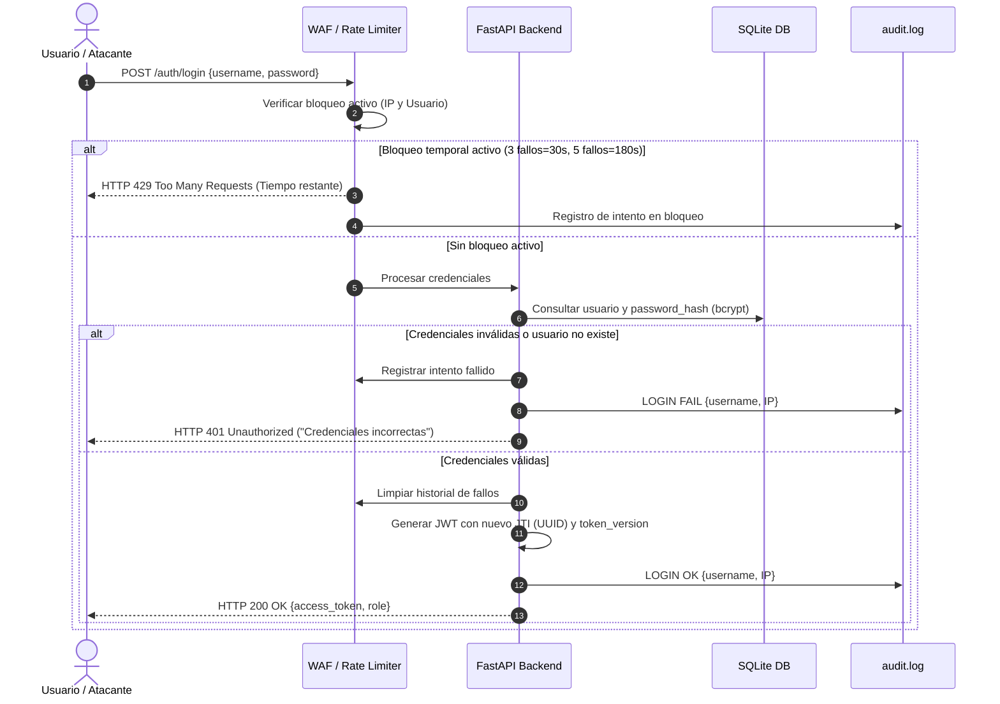
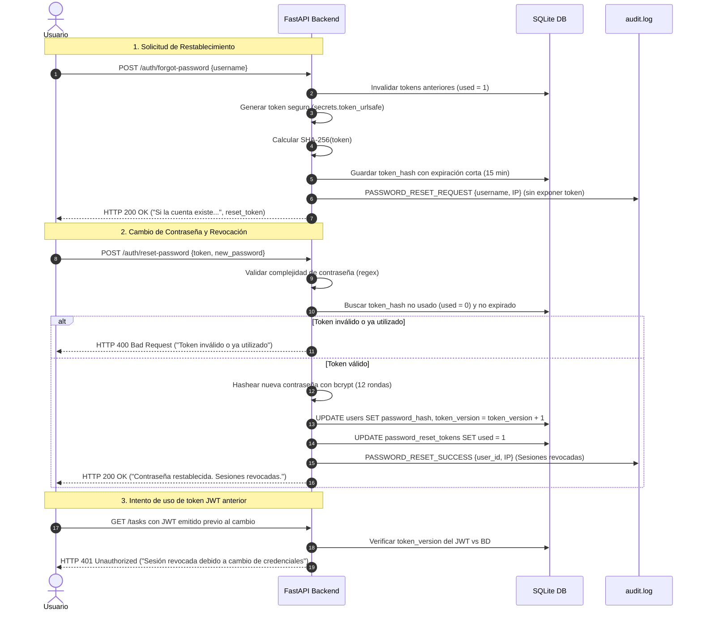

# API Segura de Gestión de Tareas - ISW UNSAAC
## Guía 4: Ingeniería de Software Seguro — Ejercicio Propuesto 1.2
### Implementación de Autenticación Resistente a Ataques Comunes

---

## 1. Diagramas de Flujo de Autenticación y Seguridad

### A. Flujo de Autenticación con Bloqueo Progresivo y Regeneración de Sesión



### B. Flujo de Restablecimiento de Contraseña y Revocación de Sesión



---

## 2. Controles de Seguridad Implementados (Guía 4 - Ejercicio 1.2)

1. **Hash Criptográfico Lento:** `bcrypt` con costo adaptativo de 12 rondas de salt para almacenamiento de contraseñas.
2. **Límite de Intentos y Bloqueo Temporal Progresivo:**
   - Seguimiento independiente por **dirección IP** y por **nombre de usuario**.
   - 3 a 4 intentos fallidos: **30 segundos** de bloqueo (`HTTP 429`).
   - 5 o más intentos fallidos: **180 segundos (3 minutos)** de bloqueo (`HTTP 429`).
3. **Mensajes Genéricos Anti-Enumeración:** Respuestas homogéneas (`401 Unauthorized: "Credenciales incorrectas"`) tanto para usuarios inexistentes como contraseñas erróneas.
4. **Regeneración de Sesión:** Cada login exitoso genera un identificador de sesión único criptográfico (`jti = UUIDv4`).
5. **Revocación de Sesión al Cambiar Contraseña:** Campo `token_version` por usuario. Al cambiar credenciales o hacer logout se incrementa el contador, invalidando de inmediato todos los JWT antiguos.
6. **Restablecimiento de Contraseña Resistente:**
   - Token aleatorio criptoseguro generado con `secrets.token_urlsafe(32)`.
   - Almacenamiento protegido: en la base de datos se guarda únicamente el hash `SHA-256` del token.
   - Expiración corta de 15 minutos.
   - Invalidación automática de tokens previos.
   - Token de un solo uso (`used = 1`).
   - Registro en `audit.log` sin exponer el contenido del token.
7. **Control de Acceso Basado en Roles (RBAC):**
   - **Estudiante:** Acceso exclusivo a sus tareas propias.
   - **Docente:** Auditoría y visualización de todas las tareas.
   - **Administrador:** Lectura, edición y eliminación de cualquier tarea.
8. **Protección Anti-IDOR y Anti-SQLi:**
   - Verificación de propiedad en servidor (`owner_id == session.user_id`).
   - Consultas con sentencias parametrizadas (*Prepared Statements* con marcadores `?`).
9. **Cabeceras HTTP de Seguridad:** Inyección de `X-Content-Type-Options: nosniff`, `X-Frame-Options: DENY`, `X-XSS-Protection: 1; mode=block`, `Referrer-Policy: strict-origin-when-cross-origin`.

---

## 3. Catálogo Completo de Endpoints

### Autenticación y Gestión de Sesión
| Método | Endpoint | Descripción | Control de Seguridad |
| :--- | :--- | :--- | :--- |
| `POST` | `/auth/register` | Registro de usuario | Hash bcrypt (12 rondas) + complejidad estricta |
| `POST` | `/auth/login` | Inicio de sesión (JWT) | Bloqueo progresivo por IP y cuenta + JTI único |
| `POST` | `/auth/logout` | Cierre de sesión seguro | Revocación en servidor (`token_version + 1`) |
| `POST` | `/auth/forgot-password` | Solicitud de restablecimiento | Token de un solo uso, expiración 15 min, anti-enumeración |
| `POST` | `/auth/reset-password` | Confirmar nueva contraseña | Invalida token, actualiza hash y revoca sesiones previas |

### Gestión de Tareas
| Método | Endpoint | Descripción | Acceso |
| :--- | :--- | :--- | :--- |
| `POST` | `/tasks` | Crear tarea | Requiere JWT |
| `GET` | `/tasks` | Listar tareas con filtros | RBAC (Estudiante: propias / Docente y Admin: todas) |
| `GET` | `/tasks/{id}` | Ver detalle de una tarea | Anti-IDOR (Dueño, Docente o Admin) |
| `GET` | `/tasks/search?q=` | Búsqueda por título | Prepared Statements contra SQLi |
| `PUT` | `/tasks/{id}` | Actualizar tarea | Anti-IDOR (Solo Dueño o Admin) |
| `DELETE` | `/tasks/{id}` | Eliminar tarea | Anti-IDOR (Solo Dueño o Admin) |
| `GET` | `/` | Servir frontend web SPA interactivo | Público |

---

## 4. Suite de Pruebas de Seguridad Automatizadas

Suite de **10 pruebas automatizadas** desarrolladas con `pytest` y `TestClient`:

```bash
python -m pytest test_security.py -v
```

| Prueba | Objetivo Verificado |
| :--- | :--- |
| `test_01_registro_y_login_seguro` | Registro con hash bcrypt, login válido y mitigación de enumeración. |
| `test_02_validacion_servidor_y_anti_mass_assignment` | Rechazo 422 ante inyección de campos no permitidos o estados inválidos. |
| `test_03_control_acceso_anti_idor` | Rechazo 403 Forbidden cuando un usuario intenta editar o eliminar tarea ajena. |
| `test_04_prevencion_inyeccion_sql` | Neutralización de payloads SQLi como `' OR 1=1 --` en búsquedas. |
| `test_05_rbac_docente_y_administrador` | Privilegios de auditoría para docentes y edición global para administradores. |
| `test_06_ciclo_crud_completo_con_endpoint_id` | Ciclo completo de vida de tarea (crear, leer por ID, editar, eliminar y 404). |
| `test_07_fuerza_bruta_bloqueo_progresivo` | Simulación de fuerza bruta: activación de bloqueo temporal `HTTP 429`. |
| `test_08_restablecimiento_contrasena_un_solo_uso` | Restablecimiento con token y verificación de que no puede reutilizarse (400). |
| `test_09_revocacion_sesion_al_cambiar_contrasena` | Verificación de que tokens JWT previos son revocados (401) tras cambio de clave. |
| `test_10_sesion_expirada` | Rechazo con 401 Unauthorized ante tokens JWT vencidos en el tiempo. |

**Resultado de ejecución:**
```text
test_security.py::test_01_registro_y_login_seguro PASSED                 [ 10%]
test_security.py::test_02_validacion_servidor_y_anti_mass_assignment PASSED [ 20%]
test_security.py::test_03_control_acceso_anti_idor PASSED                [ 30%]
test_security.py::test_04_prevencion_inyeccion_sql PASSED                [ 40%]
test_security.py::test_05_rbac_docente_y_administrador PASSED            [ 50%]
test_security.py::test_06_ciclo_crud_completo_con_endpoint_id PASSED     [ 60%]
test_security.py::test_07_fuerza_bruta_bloqueo_progresivo PASSED         [ 70%]
test_security.py::test_08_restablecimiento_contrasena_un_solo_uso PASSED [ 80%]
test_security.py::test_09_revocacion_sesion_al_cambiar_contrasena PASSED [ 90%]
test_security.py::test_10_sesion_expirada PASSED                         [100%]
======================== 10 passed in 4.45s ========================
```

---

## 5. Instrucciones de Ejecución

```bash
# 1. Instalar dependencias
pip install -r requirements.txt

# 2. Iniciar servidor local
python -m uvicorn main:app --reload --port 8000

# 3. Correr las 10 pruebas automatizadas
python -m pytest test_security.py -v
```

* **Frontend Web:** `http://127.0.0.1:8000`
* **Swagger UI Docs:** `http://127.0.0.1:8000/docs`
